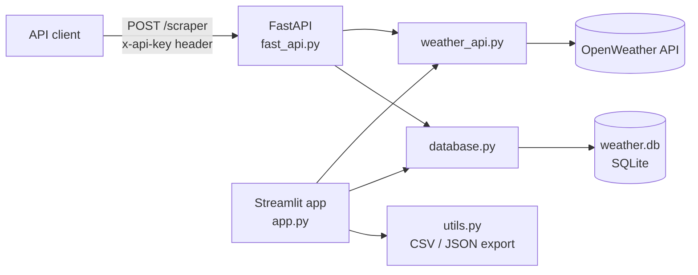

# Secure Weather Scraper (FastAPI + Streamlit)


Fetches real-time weather for any city from the OpenWeather API. There are two ways to use it:

- a **login-protected Streamlit app** to look up weather, view it as a table or JSON, and export it to CSV or JSON
- a **REST API secured with an API key**, deployed on Render, that returns the same data as JSON

Every fetch, from the app or the API, is saved to a SQLite database.

**Live API:** [vitruvia-tech-scraper-4.onrender.com/docs](https://vitruvia-tech-scraper-4.onrender.com/docs). Calling `POST /scraper` needs an API key. The free Render instance sleeps when idle, so the first request can take about 30 seconds.

## Features

- **Login and logout** for the Streamlit app, with credentials read from environment variables. The login survives a page refresh through a signed token in the URL that expires after 8 hours, and logging out invalidates it.
- **Weather for any city** in metric (°C, m/s) or imperial (°F, mph) units: temperature, feels like, min/max, humidity, conditions, wind speed, pressure, visibility and coordinates
- **Table and JSON views** of the fetched data
- **CSV and JSON export** with timestamped file names, such as `lahore_22_10_2026_14_05_33.csv`
- **Database storage**: each fetch is written to the `weather_data` table in `weather.db`
- **Secured REST endpoint**: `POST /scraper` returns `401` unless the `x-api-key` header matches the server's key
- **No secrets in code**: keys and passwords come from a `.env` file or the host's environment variables

## Tech stack

| Layer | Tools |
|---|---|
| API | FastAPI, Pydantic, Uvicorn |
| UI | Streamlit, pandas |
| Data source | OpenWeather Current Weather API (via `requests`) |
| Storage | SQLite |
| Config | python-dotenv |
| Deployment | Render |

## How it works



## Project structure

```text
├── app.py                      # Streamlit app: login, weather form, table/JSON view, export
├── fast_api.py                 # FastAPI app with the secured POST /scraper endpoint
├── weather_api.py              # calls the OpenWeather current-weather endpoint
├── database.py                 # creates the weather_data table and saves each fetch
├── utils.py                    # saves weather data as CSV or JSON
├── requirements.txt            # API dependencies (what Render installs)
├── requirements-streamlit.txt  # API dependencies plus Streamlit and pandas
└── .env.example                # environment variables to copy into .env
```

## Getting started

### 1. Clone and install

```bash
git clone https://github.com/hassankhursheed/secure-weather-scraper-fastapi-streamlit.git
cd secure-weather-scraper-fastapi-streamlit
python -m venv venv
venv\Scripts\activate          # macOS/Linux: source venv/bin/activate
pip install -r requirements-streamlit.txt
```

### 2. Configure

Copy `.env.example` to `.env` and fill in the values:

| Variable | Used by | Description |
|---|---|---|
| `OPENWEATHER_API_KEY` | app and API | Your key from [openweathermap.org](https://home.openweathermap.org/api_keys) |
| `INTERNAL_API_KEY` | API | The key clients must send in the `x-api-key` header |
| `STREAMLIT_USERNAME` | app | Login username |
| `STREAMLIT_PASSWORD` | app | Login password |

### 3. Run

Streamlit app:

```bash
streamlit run app.py
```

API (interactive docs at http://127.0.0.1:8000/docs):

```bash
uvicorn fast_api:app --reload
```

## API reference

### `GET /`

Health check.

```json
{ "message": "Weather API is running" }
```

### `POST /scraper`

Fetches the current weather for a city, saves it to the database and returns it.

- **Header:** `x-api-key: <INTERNAL_API_KEY>`
- **Body:** `{ "city": "Lahore", "unit": "metric" }`, where `unit` is `metric` (default) or `imperial`

```bash
curl -X POST http://127.0.0.1:8000/scraper \
  -H "Content-Type: application/json" \
  -H "x-api-key: YOUR_INTERNAL_API_KEY" \
  -d '{"city": "Lahore", "unit": "metric"}'
```

Example response (values change with the weather):

```json
{
  "City": "Lahore",
  "Country Code": "PK",
  "Temperature": "31.2 °C",
  "Feels Like": "33.0 °C",
  "Min Temperature": "31.2 °C",
  "Max Temperature": "31.2 °C",
  "Humidity": "48%",
  "Weather": "Haze",
  "Wind Speed": "2.1 m/s",
  "Pressure": "1009 hPa",
  "Visibility": "4000 meters",
  "Latitude": 31.5497,
  "Longitude": 74.3436,
  "Fetched At": "2026-10-22T09:15:42.123456+00:00"
}
```

| Status | When |
|---|---|
| `200` | Weather returned and saved |
| `401` | The `x-api-key` header is wrong |
| `404` | City not found |
| `422` | The header or body is missing or invalid |

## Deploying on Render

1. Create a **Web Service** from this repository.
2. Build command: `pip install -r requirements.txt`
3. Start command: `uvicorn fast_api:app --host 0.0.0.0 --port $PORT`
4. Add `OPENWEATHER_API_KEY` and `INTERNAL_API_KEY` as environment variables.

On Render's free tier the disk is temporary, so rows saved in `weather.db` reset when the service restarts.

## Author

**Hassan Khursheed** · [github.com/hassankhursheed](https://github.com/hassankhursheed)
